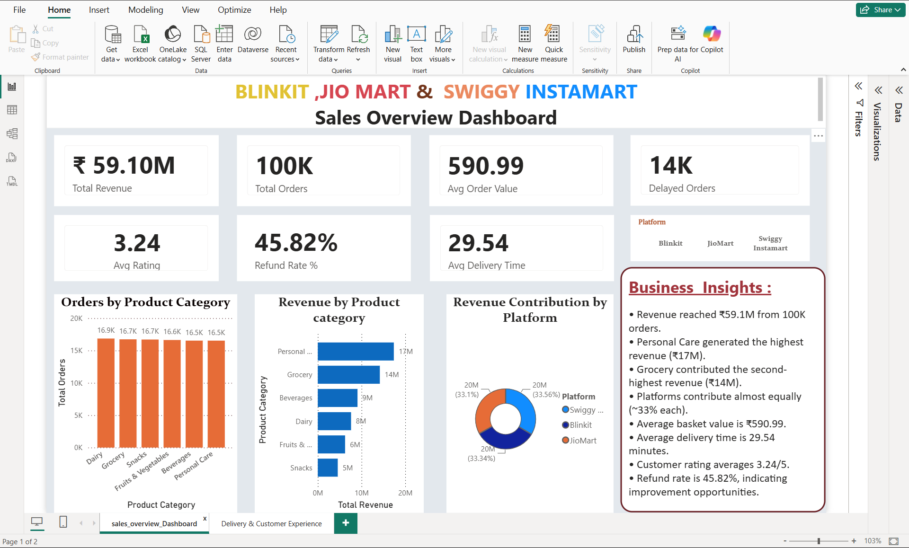

# QuickCommerce Intelligence 📊

### Cross-Platform Sales & Performance Analytics

## 📌 Project Overview

QuickCommerce Intelligence is a data analytics project focused on exploring sales performance and business trends across multiple quick-commerce platforms.

Using Microsoft Excel and Power BI, this project transforms sales data into interactive visualizations that help identify trends, monitor key performance indicators, and support data-driven business decisions.

## 🎯 Project Objectives

* Analyze sales performance and revenue trends.
* Compare business performance across platforms represented in the dataset.
* Identify product and category sales patterns.
* Monitor key performance indicators.
* Explore customer experience and operational performance where supported by the available data.
* Present insights through interactive Power BI dashboards.

## 🛠️ Tools & Technologies

* **Microsoft Excel:** Data exploration and preparation.
* **Microsoft Power BI:** Dashboard development and data visualization.
* **DAX:** KPI calculations and analytical measures, where used.

## 📂 Project Files

| File                                    | Description                         |
| --------------------------------------- | ----------------------------------- |
| `QuickCommerce sales data.xlsx`      | Excel dataset used for the analysis |
| `QuickCommerce_Intelligence_Dashboard.pbix` | Power BI dashboard file             |

## 📈 Analysis Areas

* Sales performance
* Platform comparison
* Product and category trends
* Key business performance indicators

Additional analysis areas will be documented according to the actual dashboard and available dataset.

## 🔍 Business Questions

* Which platform contributes the most to the measured sales?
* Which products or categories perform best?
* What sales trends can be identified?
* Which business areas may offer opportunities for improvement?

## 💡 Key Insights

Key findings and business recommendations will be added after validating the results against the dashboard and dataset.

## 📊 Dashboard Preview

### 1. Sales Overview Dashboard

This dashboard provides an overview of sales performance, including total revenue, total orders, average order value, product category performance, and revenue contribution across Blinkit, JioMart, and Swiggy Instamart.

### 2. Delivery & Customer Experience Dashboard

This dashboard examines delivery performance, delayed orders, refund requests, customer ratings, and differences in customer experience across platforms.

## 💡 Business Insights

Key findings cover sales performance, category revenue, platform contribution, delivery operations, customer ratings, and refund trends.

Read the complete analysis in [Business Insights](insights/business-insights.md).

## 📁 Project Resources

* 📊 [Sales Dashboard](dashboard-images/sales_overview_dashboard.png)
* 🚚 [Delivery & Customer Experience Dashboard](<dashboard-images/Delivery & Customer Experience Dashboard.png>)
* 📈 [Business Insights & Recommendations](insights/business-insights.md)

## 🚀 How to Explore This Project

1. Review the dashboard screenshots above.
2. Read the business insights and recommendations.
3. Download the Power BI `.pbix` file to explore the interactive dashboard in Power BI Desktop.
4. Review the Excel dataset to understand the data used in the analysis.

## 👨‍💻 Author

**Priyanshu Kumar**

Aspiring Data Analyst | Excel | SQL | Power BI | Python

GitHub: [analyticsbypriyanshu](https://github.com/analyticsbypriyanshu)

---

*This project is intended for educational and portfolio purposes. Platform comparisons and business conclusions depend on the scope and quality of the underlying data.*
